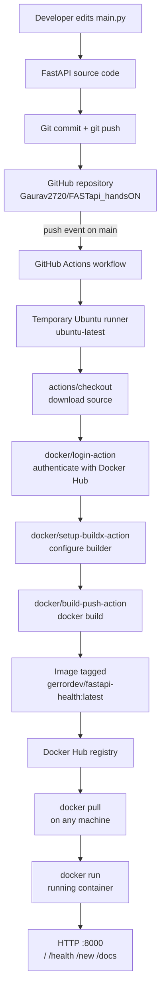
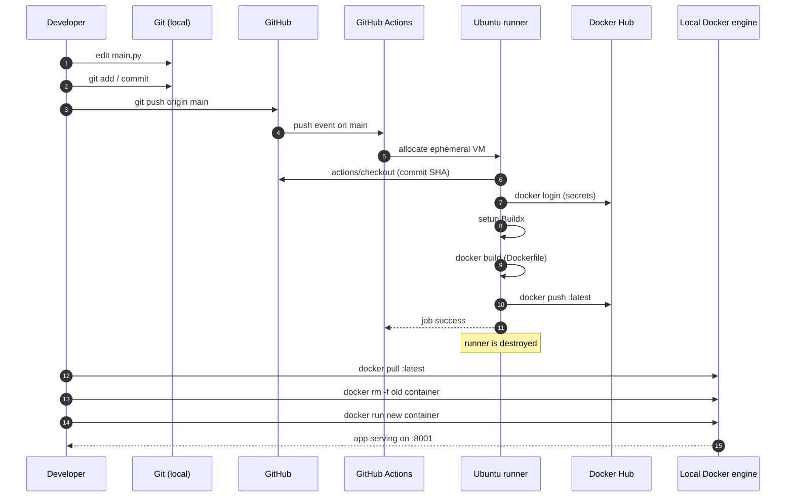

# FastAPI Docker & GitHub Actions CI/CD Lab

A complete, beginner-friendly walkthrough of building a FastAPI service, containerising it with Docker, publishing the image to Docker Hub, and automating the whole build-and-publish process with GitHub Actions.

This README is written to be used for **three purposes at once**:

1. **Lab documentation** — the exact commands, files and configuration used.
2. **Learning guide** — the *why* behind every tool, instruction and flag.
3. **Viva / evaluation preparation** — definitions, comparisons and 25+ questions with answers.

> **Quick facts (verified against the live repository and Docker Hub)**

| Item | Value |
|---|---|
| Project | FastAPI Docker and GitHub Actions CI/CD Lab |
| Backend framework | FastAPI |
| Language | Python |
| ASGI server | Uvicorn |
| Container runtime | Docker |
| Container registry | Docker Hub |
| CI/CD | GitHub Actions |
| Git hosting | GitHub |
| Docker Hub username | `gerrordev` |
| Docker image | `gerrordev/fastapi-health:latest` |
| Image digest | `sha256:aaea6c1c2f8b6c12f8852ebac4fe8e3ac3c6f8a8d37ab92ba0cb02f696314b23` |
| GitHub repository | `Gaurav2720/FASTapi_handsON` |
| Branch | `main` |
| Latest commit | `eeedeac` — *Fix FastAPI application and add new route* |
| Container port | `8000` |
| Local mapped port | `8001` |
| Base image | `python:3.12-slim` |
| Python inside container | 3.12.16 |
| Python in local virtual environment | 3.14.6 |
| Last workflow run | ✅ success (push on `main`) |

---

## Table of Contents

1. [Project Overview](#1-project-overview)
2. [Architecture and Workflow](#2-architecture-and-workflow)
3. [Technology Stack](#3-technology-stack)
4. [Project Directory Structure](#4-project-directory-structure)
5. [FastAPI Application](#5-fastapi-application)
6. [Docker Fundamentals](#6-docker-fundamentals)
7. [Dockerfile — Line-by-Line Explanation](#7-dockerfile--line-by-line-explanation)
8. [Manual Docker Build and Execution](#8-manual-docker-build-and-execution)
9. [Docker Hub — Authentication and Publishing](#9-docker-hub--authentication-and-publishing)
10. [Git and GitHub Repository Setup](#10-git-and-github-repository-setup)
11. [GitHub Secrets](#11-github-secrets)
12. [GitHub Actions — Detailed Explanation](#12-github-actions--detailed-explanation)
13. [Workflow YAML — Line-by-Line Explanation](#13-workflow-yaml--line-by-line-explanation)
14. [The Complete CI/CD Lifecycle](#14-the-complete-cicd-lifecycle)
15. [Testing and Verification](#15-testing-and-verification)
16. [Troubleshooting — Errors Encountered](#16-troubleshooting--errors-encountered)
17. [Docker Command Cheat Sheet](#17-docker-command-cheat-sheet)
18. [Git Command Cheat Sheet](#18-git-command-cheat-sheet)
19. [Advantages and Limitations](#19-advantages-and-limitations)
20. [Viva Questions and Answers](#20-viva-questions-and-answers)
21. [Final Learning Summary](#21-final-learning-summary)

---

## 1. Project Overview

### What this project does

This lab builds a very small but **production-shaped** pipeline:

- A **FastAPI** web service with three HTTP endpoints.
- The service is **packaged into a Docker image** so it runs identically on any machine.
- The image is **published to Docker Hub**, a public registry, so anyone (or any server) can pull it.
- **GitHub Actions** rebuilds and republishes that image automatically every time source code is pushed to the `main` branch.

The result: you change one line of Python, run three Git commands, and within a minute a fresh image exists on Docker Hub — with no manual build, no manual login, no manual push.

### Why FastAPI?

FastAPI is a modern Python framework for building HTTP APIs. It was chosen here because:

- It is **fast** (built on Starlette and Pydantic).
- It generates **automatic interactive documentation** at `/docs` — invaluable for testing.
- Endpoints are declared with **decorators**, so a working API is 10 lines of code.
- It is **ASGI-based**, meaning it handles many concurrent requests efficiently.

### What Docker solves

"It works on my machine" is the oldest problem in software. Your laptop may have Python 3.14, a different FastAPI version, a different OS, different system libraries.

Docker solves this by packaging your **application + its interpreter + its libraries + its OS-level dependencies** into a single artifact — an **image**. That image runs the same way on your laptop, your friend's Mac, a CI runner, and a cloud server.

### Why publish images to Docker Hub?

Docker Hub is a **registry**: a central store for images. Publishing there means:

- The image is downloadable by name from anywhere: `docker pull gerrordev/fastapi-health:latest`.
- Servers do not need your source code or Python installed — only Docker.
- Every deployment point pulls the **same artefact**, eliminating environment drift.
- It acts as the hand-off point between **CI** (build) and **deployment** (run).

### What GitHub Actions does

GitHub Actions is a **CI/CD service built into GitHub**. You describe, in a YAML file, what should happen when something occurs in the repository — for example, "when code is pushed to `main`, build the Docker image and push it to Docker Hub". GitHub then runs those instructions on a temporary machine it provides.

### What CI/CD means

| Term | Meaning | In this lab |
|---|---|---|
| **CI** — Continuous Integration | Automatically verify/build every change | Every push builds a Docker image; a broken Dockerfile fails immediately |
| **CD** — Continuous Delivery/Deployment | Automatically make the built artefact available | The image is automatically pushed to Docker Hub, ready to deploy |

The pipeline is *Continuous Delivery*, not full *Continuous Deployment*: the new image is published, but nothing automatically restarts your running container.

### Real-world explanation

> Think of a **factory**.
> - The **source code** is the raw material.
> - **GitHub** is the warehouse where the material is stored and versioned.
> - **GitHub Actions** is the assembly line that starts automatically whenever new material arrives.
> - The **Docker build** is the machine that assembles the product.
> - **Docker Hub** is the shop shelf where the finished product is placed.
> - Your **server/container** is the customer who takes the product off the shelf.
>
> Nobody has to manually switch on the assembly line. A push is the switch.

### Objective of automation

Before automation, every code change required:

```text
edit code → docker build → docker login → docker push → ssh to server → docker pull → docker stop/rm → docker run
```

That is ~7 manual steps, each one a chance to forget a flag or use the wrong tag. Automating build + publish reduces it to:

```text
edit code → git add/commit/push
```

and removes the human error from the most mechanical part.

---

## 2. Architecture and Workflow

### Diagram



### Component-by-component explanation

| Component | Role in the flow |
|---|---|
| **Developer** | Writes the FastAPI code and triggers the pipeline with `git push`. |
| **FastAPI source code** | The application: `main.py`, `requirements.txt`, `Dockerfile`. |
| **GitHub repository** | Version control + the trigger source. It hosts the code and the workflow definition. |
| **GitHub Actions** | The orchestrator. Watches for the `push` event and schedules a job. |
| **Ubuntu runner** | A disposable virtual machine created by GitHub for that single job. |
| **Docker build** | Reads the Dockerfile and assembles layers into an image. |
| **Docker Hub** | Stores the resulting image under a name and tag. |
| **`docker pull`** | Downloads the image onto a target machine. |
| **Running container** | The image instantiated as a live process, serving HTTP on port 8000. |

### Two distinct loops

It is important to see this as **two loops**, not one:

- **Build loop (automatic):** push → Actions → image in registry. Fully hands-off.
- **Run loop (manual, in this lab):** pull → stop old container → run new container. Still your job.

The registry is the seam between them. That seam is deliberate: it lets you deploy on a schedule, to many servers, or behind an approval gate.

---

## 3. Technology Stack

| Technology | Role in this project |
|---|---|
| **Python** | The programming language. Runs the application logic in `main.py`. Version 3.12 inside the container, 3.14 in the local virtual environment. |
| **FastAPI** | The web framework. Turns Python functions into HTTP endpoints, validates requests, and generates OpenAPI/Swagger docs automatically at `/docs`. |
| **Uvicorn** | The ASGI server. A framework cannot listen on a socket by itself; Uvicorn is the process that actually accepts HTTP connections and passes them to FastAPI. Also used with `--reload` during development. |
| **Docker** | The container platform. Builds and runs the image, isolating the app from the host OS. |
| **Dockerfile** | The recipe — a text file of instructions describing how to build the image. |
| **Docker Image** | The immutable, layered artefact produced by `docker build`. Contains the OS base, Python, dependencies and your code. |
| **Docker Container** | A running (or stopped) instance of an image — an isolated process plus its filesystem and network namespace. |
| **Docker Hub** | The remote registry that stores and distributes images (`gerrordev/fastapi-health`). |
| **GitHub** | Hosts the Git repository, the workflow file and the encrypted secrets. |
| **GitHub Actions** | The CI/CD engine that executes the workflow on GitHub-hosted runners. |
| **YAML** | The human-readable configuration format of the workflow. Indentation = structure. |
| **GitHub Secrets** | Encrypted key/value storage for credentials (`DOCKERHUB_USERNAME`, `DOCKERHUB_TOKEN`) that the workflow reads at runtime without exposing the values. |

### Docker image vs Docker container

| | Docker Image | Docker Container |
|---|---|---|
| **What it is** | A read-only template: filesystem layers + metadata + start command | A running process created from an image, with a writable layer on top |
| **State** | Immutable — never changes once built | Mutable — has runtime state (PID, memory, logs) |
| **Analogy** | A class in OOP, or a `.exe` file | An object/instance of that class, or the running process |
| **Created by** | `docker build` (or `docker pull`) | `docker run` (or `docker create`) |
| **Stored where** | Local image cache / registry | On the Docker engine as a container |
| **How many** | One image | Many independent containers from the same image |

> One image → many containers. Stopping and deleting a container does not touch the image.

### GitHub vs GitHub Actions

| | GitHub | GitHub Actions |
|---|---|---|
| **What it is** | A platform for hosting Git repositories, issues, pull requests, code review | A CI/CD automation service *inside* GitHub |
| **Core object** | Repository, commit, branch | Workflow, job, step, runner |
| **Purpose** | Store and collaborate on code | Execute tasks in response to repository events |
| **Required here?** | Yes — the code must live somewhere | Yes — it reads `.github/workflows/*.yml` from the repository |
| **Boundary** | GitHub Actions requires a GitHub repo | You can use GitHub without ever using Actions |

---

## 4. Project Directory Structure

### Actual layout (important)

The Git repository root and the **application directory** are *not* the same folder. GitHub reads workflows **only** from the repository root's `.github/workflows/`, while the app lives one level down.

```text
Githubactions/                          <-- GIT REPOSITORY ROOT
├── .git/                               <-- repository metadata (created by git init/clone)
├── .github/
│   └── workflows/
│       └── docker-publish.yml          <-- THE ACTIVE WORKFLOW (GitHub reads this one)
├── .gitignore                          <-- what Git must NOT commit
├── README.md                           <-- this document
└── FASTapi_handsON/                    <-- APPLICATION DIRECTORY (Docker build context)
    ├── .dockerignore                   <-- what Docker must NOT copy into the image
    ├── .github/
    │   └── workflows/
    │       └── docker-publish.yml      <-- leftover copy, NOT executed by GitHub (see note)
    ├── Dockerfile                      <-- image build recipe
    ├── main.py                         <-- the FastAPI application
    ├── requirements.txt                <-- Python dependencies
    ├── __pycache__/                    <-- generated, ignored by Git and Docker
    └── venv/                           <-- local virtual environment, ignored by Git and Docker
```

**Verified sizes:** the application directory is ~29.4 MB, and virtually all of that is `venv/` (installed packages). The Git repository itself is ~0.05 MB, because `venv/` and `__pycache__/` are ignored.

> **Note on the duplicated workflow file**
> `FASTapi_handsON/.github/workflows/docker-publish.yml` is a **copy left over from earlier experimentation**. GitHub only reads `.github/workflows/` at the *repository root*, so the nested copy is **never executed**. It is also slightly different from the active one (it lacks the `permissions:` block and uses `context: .` instead of `context: ./FASTapi_handsON`). It is tracked by Git, so it appears in the repo — but it is inert. Recommended cleanup: delete it so nobody edits the wrong file.

### Purpose of every file

| File | Purpose |
|---|---|
| `README.md` | Documentation (this file). |
| `.gitignore` | Tells Git which paths to leave untracked: `venv/`, `__pycache__/`, `*.pyc`, `.env`, build caches, editor folders. Keeps the repository small and prevents committing secrets. |
| `.github/workflows/docker-publish.yml` | The CI/CD pipeline. Defines *when* to run (push to `main`) and *what* to do (build + push the image). |
| `FASTapi_handsON/main.py` | The application source: three endpoints. |
| `FASTapi_handsON/requirements.txt` | Declares `fastapi` and `uvicorn`; installed by both the Dockerfile and the local venv. |
| `FASTapi_handsON/Dockerfile` | The image recipe: base image, workdir, dependency install, code copy, port, start command. |
| `FASTapi_handsON/.dockerignore` | Excludes `venv/`, `__pycache__/`, `.git/` from the **build context** so the image stays small and builds fast. |
| `FASTapi_handsON/.github/workflows/docker-publish.yml` | Inert leftover copy (see note above). |

### Why `.github/workflows/` is required

GitHub scans that exact path at the **repository root** on every push. It parses each `.yml`/`.yaml` file there, registers the workflows, and evaluates their `on:` triggers.

- Wrong folder (`FASTapi_handsON/.github/...`) → GitHub never sees it, the Actions tab shows nothing, no runs occur.
- Wrong extension (`.txt`, `.yml.bak`) → not parsed.
- Invalid YAML → the workflow appears but fails immediately with a syntax error.

### Why `docker-publish.yml` is written in YAML

YAML is a **data-serialisation format** built on key/value pairs and indentation. GitHub chose it for workflows because:

- It is human-editable in a plain text editor and diff-friendly in pull requests.
- Nesting (`jobs → steps → with`) maps naturally onto a pipeline structure.
- It supports comments (`#`), so the pipeline can document itself.
- It is language-agnostic — no compilation step needed.

The trade-off: indentation is *semantic*. Two spaces vs four spaces, or a stray tab, changes the meaning or breaks parsing.

### Why `.dockerignore` and `.gitignore` are different

They solve different problems, for different tools, at different times:

| | `.gitignore` | `.dockerignore` |
|---|---|---|
| **Consumed by** | Git | Docker (the build process) |
| **Question answered** | "What should be version-controlled?" | "What should be sent to the builder as build context?" |
| **Applies to** | Commits, pushes, repo size | `COPY`/`ADD` operations, build speed, image size |
| **Typical entries** | `venv/`, `__pycache__/`, `.env`, `*.log` | `venv/`, `__pycache__/`, `.git/`, `node_modules/`, docs |
| **If you skip it** | Repo bloats; secrets may leak into history | Multi-hundred-MB context uploads, bloated images, leaked secrets baked into layers |

**Critical difference:** a file ignored by Git is **not** automatically ignored by Docker. If a file exists on disk but is not in `.dockerignore`, `COPY . .` will still put it in the image. That is why both files exist.

---

## 5. FastAPI Application

### Complete final `main.py`

```python
from fastapi import FastAPI

# Step 1: Create FastAPI application
app = FastAPI()


# Step 2: Home route
@app.get("/")
def home():
    return {
        "message": "FastAPI is running"
    }


# Step 3: Health check route
@app.get("/health")
def health():
    return {
        "status": "ok"
    }


# Step 4: New route added for GitHub Actions testing
@app.get("/new")
def new_route():
    return {
        "message": "Updated automatically using GitHub Actions!"
    }
```

### Line-by-line explanation

| Code | Meaning |
|---|---|
| `from fastapi import FastAPI` | Imports the `FastAPI` class from the installed `fastapi` package. If this fails, the package is not installed in the active environment. |
| `app = FastAPI()` | Creates the **application object**. This object holds the routing table, middleware, OpenAPI metadata and the ASGI callable Uvicorn will serve. It must exist **before** any decorator that references it. |
| `@app.get("/")` | A **decorator**. It registers the function below it in `app`'s routing table, bound to `GET /`. |
| `def home():` | A plain Python function — the **handler**. Called by FastAPI when a matching request arrives. |
| `return {"message": ...}` | Returning a `dict` makes FastAPI serialise it to JSON automatically, with `Content-Type: application/json`. |
| `@app.get("/health")` + `{"status": "ok"}` | Standard convention: a cheap endpoint that reports whether the service is alive. |
| `@app.get("/new")` | Added later purely to prove the CI/CD pipeline shipped a **new version** of the code, not a cached image. |

### Function-based endpoints

A function-based endpoint is the simplest FastAPI pattern:

```python
@app.get("/path")
def handler():
    return {...}
```

FastAPI inspects the function signature to decide how to parse the request. With no parameters, no inputs are read. With parameters typed as Pydantic models or query params, FastAPI generates validation and documents them automatically. (Class-based endpoints with `APIRouter` exist for larger apps but are unnecessary here.)

### JSON responses

HTTP bodies are bytes. FastAPI's `jsonable_encoder` + Starlette's `JSONResponse` convert Python objects into JSON:

```json
{ "message": "FastAPI is running" }
```

Supported return types include `dict`, `list`, Pydantic models, and `JSONResponse`. FastAPI also validates the *response* if you declare a `response_model`, which is how it keeps API contracts honest.

### What a health-check endpoint is and why it matters

`GET /health` is a **liveness probe**: a fast, side-effect-free endpoint that always reports whether the process is healthy.

Why it matters:

- **Docker/Kubernetes** can use it as a `HEALTHCHECK` probe to restart unhealthy containers.
- **Load balancers** use it to decide whether to route traffic to this instance.
- **CI/CD and smoke tests** use it to confirm a deploy actually came up.
- **Monitoring** alerts on a change from `ok` to a timeout.
- It must **not** do heavy work (no DB queries, no external calls) — otherwise it reports dependency health, not process health.

### `requirements.txt`

```text
fastapi
uvicorn
```

| Package | Why it is a dependency |
|---|---|
| `fastapi` | The framework itself. Pulls in `starlette` (ASGI toolkit), `pydantic` (validation), `anyio`, `typing-extensions`. |
| `uvicorn` | The ASGI **server**. Without it, the app has nothing to listen on a socket. It provides the `uvicorn` executable used in the Dockerfile `CMD` and locally. |

> **Improvement worth knowing:** these are unpinned, so every build can resolve to a newer release. At the time of this lab the container resolved `fastapi==0.163.1` and `uvicorn==0.54.0`. For reproducible builds, pin them:
> ```text
> fastapi==0.163.1
> uvicorn[standard]==0.54.0
> ```

### Local setup and execution (Windows / PowerShell)

**1. Create a virtual environment**

```powershell
python -m venv venv
```

Creates an isolated folder `venv/` containing its own Python interpreter and `pip`, so this project's packages do not pollute the global Python.

**2. Activate it**

```powershell
.\venv\Scripts\Activate.ps1
```

If PowerShell blocks the script, allow local scripts for the session:

```powershell
Set-ExecutionPolicy -Scope Process -ExecutionPolicy Bypass
```

(Alternatively use `venv\Scripts\activate.bat` in `cmd.exe`.)

**3. Install dependencies**

```powershell
pip install -r requirements.txt
```

**4. Run the app**

```powershell
uvicorn main:app --reload --host 127.0.0.1 --port 8000
```

| Part | Meaning |
|---|---|
| `main:app` | Module `main.py` → object `app` (the same `app = FastAPI()`). |
| `--reload` | Watches files and restarts on save. **Development only.** |
| `--host 127.0.0.1` | Listen only on loopback (local machine). |
| `--port 8000` | TCP port to bind. If occupied, use `--port 8001`. |

**5. Test in the browser**

| URL | Expected response |
|---|---|
| `http://127.0.0.1:8000/` | `{"message":"FastAPI is running"}` |
| `http://127.0.0.1:8000/health` | `{"status":"ok"}` |
| `http://127.0.0.1:8000/new` | `{"message":"Updated automatically using GitHub Actions!"}` |
| `http://127.0.0.1:8000/docs` | Interactive **Swagger UI** documentation |
| `http://127.0.0.1:8000/openapi.json` | Machine-readable OpenAPI schema |

**Swagger UI (`/docs`)** is generated from the code, not written by hand. It lets you click "Try it out" on each endpoint, see the exact JSON schema, and verify status codes — extremely useful before writing any client.

---

## 6. Docker Fundamentals

### What is Docker?

Docker is a platform for building, shipping and running applications in **containers** — lightweight, isolated user-space environments that share the host's kernel.

### What problem does containerisation solve?

Classic failure modes:

- "It works on my laptop but not on the server." (Different Python/library versions.)
- "The deploy broke because someone upgraded a system package."
- "Onboarding takes two days: install Python 3.12, pin these libs, install this compiler..."

Containerisation removes the *environment* as a variable. You ship the environment **with** the app. The server only needs a container runtime.

**Analogy:** shipping containers. Before standard steel boxes, every cargo type needed custom handling. Once the box was standardised, cranes, ships and trucks could all handle *any* cargo the same way. Docker makes your app a standard box.

### What is a Docker image?

A **read-only, layered filesystem snapshot** plus configuration (env vars, entrypoint, exposed ports).

- Layers are content-addressed and **cached/reused**.
- Immutable: once built, the image never changes.
- Identified by `name:tag` and a `sha256` **digest**.

### What is a Docker container?

A **running instance** of an image: a normal host process with:

- its own filesystem view (image layers + a thin writable layer),
- its own network namespace and IP,
- its own process tree,
- resource limits (CPU/memory) if configured.

**Analogy:** image = `.exe` file; container = the running program. Or: image = class, container = object.

### What is Docker Hub?

The default **public registry** for Docker images. It stores repositories (`username/image`) with tags. It performs:

- **authentication** (who are you?),
- **authorisation** (may you push to this repo?),
- storage and CDN distribution of compressed layers.

### What is a base image?

The starting filesystem for your image, declared in `FROM`. Here: `python:3.12-slim`.

- `python` is the official repository.
- `3.12` is the minor version.
- `slim` is the variant: Debian minimal, no compilers or docs — much smaller than the full image.

Your instructions then add layers **on top** of it.

### What is port mapping?

Containers have their own network namespace, so a port inside the container is **not** automatically reachable from the host. Port mapping publishes it:

```text
-p HOST_PORT:CONTAINER_PORT
```

Example `-p 8001:8000`: traffic to host port 8001 is forwarded to port 8000 inside the container. Publishing is done by Docker's proxy (`docker-proxy`) or iptables/NAT rules.

**Analogy:** a building's reception desk (host port) forwarding a visitor to the right room (container port). The room number never changes; the desk extension can.

### Why Docker makes applications portable

The image carries:

- the OS userland it needs,
- the exact interpreter,
- the exact libraries,
- the start command,
- the declared port.

So "works on my machine" becomes "works anywhere Docker runs" — laptop, Windows with WSL2, Linux server, CI runner, cloud VM. Same digest in, same behaviour out.

---

## 7. Dockerfile — Line-by-Line Explanation

### The file

```dockerfile
# Use Python base image
FROM python:3.12-slim

# Set working directory
WORKDIR /app

# Copy dependencies
COPY requirements.txt .

# Install dependencies
RUN pip install --no-cache-dir -r requirements.txt

# Copy application code
COPY . .

# Expose application port
EXPOSE 8000

# Start FastAPI server
CMD ["uvicorn", "main:app", "--host", "0.0.0.0", "--port", "8000"]
```

### Instruction by instruction

| Instruction | What it does | Why here |
|---|---|---|
| **`FROM python:3.12-slim`** | Sets the base image. Every later instruction applies on top of it. | `3.12-slim` gives a modern Python with a minimal Debian userland — small but complete enough for `pip install`. |
| **`WORKDIR /app`** | Creates `/app` (if missing) and makes it the working directory for `RUN`, `COPY`, `CMD`, `ENTRYPOINT`. | Keeps paths predictable: no `/usr/src/app` guesswork, and `main:app` resolves regardless of where the process starts. |
| **`COPY requirements.txt .`** | Copies *only* the dependency manifest from the build context to `/app/requirements.txt`. | Deliberate: this layer changes rarely, so its cache survives code edits. |
| **`RUN pip install --no-cache-dir -r requirements.txt`** | Executes during the build, in a new layer, installing dependencies system-wide in the image. | `--no-cache-dir` avoids storing the pip download cache inside the image — smaller final image. |
| **`COPY . .`** | Copies the rest of the build context into `/app`. | After dependencies are installed, so editing `main.py` does not invalidate the dependency layer. |
| **`EXPOSE 8000`** | Documentation/metadata: "this image listens on 8000". | It does **not** publish the port. Publishing happens at `docker run -p`. It is a signal to humans and tooling (and used by `-P`). |
| **`CMD ["uvicorn", "main:app", "--host", "0.0.0.0", "--port", "8000"]`** | The default command executed when a container starts, in **exec (JSON) form**. | Exec form runs `uvicorn` directly as PID 1 — no shell wrapper, so signals (SIGTERM/SIGINT) reach the server and it shuts down cleanly. |

### Why `0.0.0.0` instead of `127.0.0.1`

| Address | Meaning | Consequence in a container |
|---|---|---|
| `127.0.0.1` / `localhost` | Loopback **inside the container's own network namespace** | Only reachable from inside that container. Port mapping from the host **fails** — this is the classic "container is running but ERR_CONNECTION_REFUSED" bug. |
| `0.0.0.0` | All interfaces of the container's namespace | Docker's bridge can forward host/other-container traffic to it. Correct for containers. |

So: `0.0.0.0` **inside** the container, and `127.0.0.1` is fine for local non-Docker development.

### Why port 8000

- Uvicorn's default is 8000, so it is the ecosystem convention and requires no explanation to other developers.
- It is unprivileged (>1024), so no root capability is needed to bind it.
- It is consistently used in `EXPOSE`, `CMD` and the CI documentation, so there is exactly one port to remember.

### Why dependencies are copied before the source (layer caching)

Docker executes instructions in order and caches each layer keyed by (parent layer + instruction). On a rebuild, Docker reuses a cached layer while the inputs are unchanged.

```text
FROM          -> cached
WORKDIR       -> cached
COPY reqs     -> invalidated only when requirements.txt changes
RUN pip ...   -> cached unless requirements.txt changed
COPY . .      -> invalidated on ANY source change
CMD           -> metadata only
```

If you instead did `COPY . .` first, **every** code edit would invalidate the dependency layer and trigger a full `pip install` (~30–60 s). With the split, editing `main.py` reuses the installed dependencies and rebuilds in ~1 s.

**Analogy:** you do not re-groceries-shop every time you change a recipe's garnish.

### `.dockerignore`

```text
venv/
__pycache__/
.git/
```

| Entry | Why it must be excluded |
|---|---|
| `venv/` | The virtual environment contains host-specific binaries and absolute paths (`C:\...`, `/Users/...`). Copying it into a Linux image is useless and can break imports. The container installs its own dependencies. It is also ~29 MB of build context. |
| `__pycache__/` | Compiled `.pyc` files are regenerate-able and architecture/version-specific. |
| `.git/` | Repository history is not needed to run the app; excluding it keeps context tiny and avoids leaking commit metadata. |

Excluding these makes the **build context** (the bytes sent to the builder) small, builds faster, and images smaller and safer.

### About layers and image size

Each `RUN`, `COPY` and `ADD` creates a layer. Layers are additive — deleting a file in a later layer does not shrink the image, because the earlier layer still contains it. That is why:

- `--no-cache-dir` matters (avoids writing a cache you can never remove),
- installing and cleaning in one `RUN` matters,
- ordering matters for cache hits.

---

## 8. Manual Docker Build and Execution

### Commands

```bash
docker --version
docker info

# Run from the application directory (where the Dockerfile lives)
cd FASTapi_handsON
docker build -t gerrordev/fastapi-health:latest .
docker images

docker run -d -p 8000:8000 --name fastapi-container gerrordev/fastapi-health:latest
docker ps
docker logs fastapi-container
```

### What each command does

| Command | Meaning |
|---|---|
| `docker --version` | Prints the **client** version. Confirms Docker is installed and on `PATH`. |
| `docker info` | Prints engine-wide info: server version, storage driver, CPU/memory, containers/images count, registry config. Confirms the **daemon** is actually running. |
| `docker build -t NAME:TAG .` | Builds an image from the Dockerfile in the current directory. |
| `docker images` | Lists local images with tags, image IDs and sizes. |
| `docker run -d ...` | Creates **and starts** a container from an image. |
| `docker ps` | Lists **running** containers, their port mappings and status. |
| `docker logs fastapi-container` | Prints the container's stdout/stderr — where Uvicorn logs requests and startup. |

### Flag-by-flag

| Flag | Meaning | Notes |
|---|---|---|
| **`-t`** (build) | `--tag`, in `repository:tag` form | `gerrordev/fastapi-health:latest`. Without a tag, Docker appends `:latest`. The repository part must match your Docker Hub namespace to be pushable. |
| **`.`** (build) | The **build context** — the directory sent to the builder | Not "the Dockerfile path". It is the sandbox from which `COPY` reads. Running from the wrong folder is the #1 cause of `requirements.txt not found`. |
| **`-d`** | `--detach`: run in the background | Without it, `docker run` occupies your terminal and Ctrl+C kills the container. |
| **`-p 8000:8000`** | `HOST:CONTAINER` port mapping | Left of `:` is your machine, right is the container. |
| **`--name fastapi-container`** | Assigns a readable name | Fixed names must be unique. If it already exists, `docker run` fails with a name conflict — use `docker rm -f fastapi-container` or pick a new name. |
| **`-it`** (not used) | Interactive + TTY | For shells/debugging, not for a background service. |

### Testing through the browser

```text
http://localhost:8000/          -> {"message":"FastAPI is running"}
http://localhost:8000/health    -> {"status":"ok"}
http://localhost:8000/new       -> {"message":"Updated automatically using GitHub Actions!"}
http://localhost:8000/docs      -> Swagger UI
```

If it fails, check `docker ps` first: does the container say `Up`, and does the port mapping look right?

### Host port vs container port

```text
Browser -> localhost:8000 -> [docker-proxy] -> container IP:8000 -> Uvicorn
          ^^^^^^^^^^^^^^^^                     ^^^^^^^^^^^^^^^^^^
          HOST port                            CONTAINER port
```

- The **container port** is decided by your app (`CMD ... --port 8000`) and declared by `EXPOSE`. It is fixed inside the image.
- The **host port** is chosen per-run and can be anything free on your machine.
- Many containers can publish different host ports while all using 8000 internally.
- If the host port is already taken (for example, by another container or a local `uvicorn`), the container may fail to start or bind an unexpected port.

### The later command with 8001

```bash
docker run -d -p 8001:8000 --name fastapi-container gerrordev/fastapi-health:latest
```

**Why map 8001 → 8000?**

- Port **8000 on the host was already in use** — a local `uvicorn` instance, another container, or a leftover process. Docker cannot bind an occupied host port.
- The container's internal port stays **8000**, because the image is built for 8000 (`EXPOSE`/`CMD`). Changing the container port would require rebuilding the image or overriding the CMD.
- Therefore only the left side changed: host **8001** → container **8000**.
- Test URL becomes `http://localhost:8001/`.

This is the practical demonstration of the host/container distinction: **one image, any host port.**

> In this lab the running container maps `8000/tcp -> 8001`, which is why all verification requests use `http://localhost:8001`.

---

## 9. Docker Hub — Authentication and Publishing

### Why Docker Hub

It is the default, free, public registry that Docker itself uses by default. It provides:

- a named repository (`gerrordev/fastapi-health`),
- immutable content-addressed layers,
- a pull path that needs no source code or credentials (public repos),
- visibility: the image URL can be shared with an evaluator or a server.

### What a Docker Hub repository is

A **namespace for image tags**. `gerrordev/fastapi-health` holds many tags of the same logical image:

```text
gerrordev/fastapi-health:latest
gerrordev/fastapi-health:eeedeac
gerrordev/fastapi-health:v1.0.0
```

Each tag points to a manifest with a digest. The repository is not the image; it is the *container of versions*.

### What a tag means

A tag is a **mutable human-readable pointer** to a digest:

```text
gerrordev/fastapi-health:latest  ->  sha256:aaea6c1c2f8b...
```

- `latest` is only a convention, not "the newest" magically — but it *is* what gets used when you omit a tag.
- Tags can be moved (that is why the same `latest` can change after every CI run).
- Digests cannot change. Pinning by digest is the only way to guarantee "exactly this build".

That is why best practice is to push **both** a moving tag (`latest`) and an immutable one (git SHA or semver).

### Why an account is needed

Pushing is a **write** operation to a namespace. Docker Hub must know who owns `gerrordev` and whether they are allowed to publish. Pulling a public image needs no account.

### Password vs Personal Access Token

| | Account password | Personal Access Token (PAT) |
|---|---|---|
| **Scope** | Full account access | Can be limited (read / write / delete) |
| **Revocable** | Changing it breaks everything | Delete one token; other sessions keep working |
| **Exposure blast radius** | Account takeover, billing, email | Limited to the scopes you granted |
| **2FA compatibility** | Often blocked | Designed for automation |
| **Audit** | No per-use identity | Named token, last-used info |

A PAT is preferable because CI systems store credentials in a third party (GitHub). If that secret leaks, a scoped token can be revoked instantly without changing your password.

### Creating the token

1. Sign in to Docker Hub → **Account settings** → **Security** → **New Access Token**.
2. Give it a descriptive name, e.g. `github-actions-fastapi`.
3. Choose **Read & Write** (needed to push).
4. Copy the token immediately — it is shown **once**.
5. Store it as the GitHub secret `DOCKERHUB_TOKEN`. Never paste it into a file, a commit, or this README.

### `docker login`

```powershell
docker login -u gerrordev
```

- `-u gerrordev` supplies the username.
- Docker prompts for the password: **paste the PAT**, not your account password.
- Docker encodes `username:password` in base64 and POSTs it to the registry auth endpoint, receiving a JWT.
- The token is cached in `%USERPROFILE%\.docker\config.json` (Windows) — treat that file as a secret.

Success message: `Login Succeeded`.

### Why `--password-stdin` is useful

```powershell
$env:DOCKERHUB_TOKEN | docker login -u gerrordev --password-stdin
```

| Reason | Explanation |
|---|---|
| **No shell history** | A password typed as an argument lands in PowerShell history, `ps` output, and CI logs. `--stdin` avoids argv exposure entirely. |
| **No interactive prompt** | Required for automation — CI has no terminal to prompt at. |
| **Explicit, scriptable** | The secret comes from an environment variable injected by the CI secret store. |
| **Recommended by Docker** | Docker's own docs recommend `--password-stdin` for scripts. |

### Authentication vs authorisation

| | Authentication | Authorisation |
|---|---|---|
| **Question** | Who are you? | What are you allowed to do? |
| **Mechanism here** | `docker login` with username + PAT → identity proven | The PAT's scope + repository ownership → push permitted |
| **Failure looks like** | `unauthorized: incorrect username or password` | `denied: requested access to the resource is denied` |

You can be successfully **authenticated** and still **denied** a push (wrong namespace, read-only token). CI logs distinguish the two — read the message carefully.

### Push and pull

```bash
docker push gerrordev/fastapi-health:latest
docker pull gerrordev/fastapi-health:latest
```

**What push does:**

1. Reads the image manifest and its layer list.
2. Queries the registry: which layers already exist?
3. Uploads only the **missing** layers as compressed blobs.
4. Uploads the manifest, creating the tag.

**Why an interrupted push can be retried safely:** layers are **content-addressed**. Ones already uploaded are acknowledged and skipped. Re-running `docker push` resumes from where it stopped — no rebuild needed. That is why a timeout during upload is usually solved by simply retrying.

Pull does the inverse: fetch the manifest, download missing layers, unpack, and create local tags.

> **Never commit tokens.** No token, password or secret value appears in this README, in the workflow, or in any tracked file. Secrets live only in GitHub's encrypted secret store.

---

## 10. Git and GitHub Repository Setup

### What Git is

A **distributed version control system**. Every clone contains the full history. Commits form a directed acyclic graph, and each commit is a content hash — which is what makes history tamper-evident.

### What GitHub is

A hosting and collaboration platform built on Git: remote repositories, pull requests, issues, Actions, releases, permissions, secrets. Git is the tool; GitHub is the service.

### Why a separate repository

- The pipeline is tied to **one** repository and one default branch.
- Separation keeps the lab reproducible: clone → push → pipeline runs.
- Secrets and workflows are scoped per repository, limiting blast radius.
- Evaluation is easier: one URL, one history, one Actions tab.

### Core commands

| Command | What it does |
|---|---|
| `git init` | Creates `.git/` — turns a folder into a repository. No remote yet. |
| `git add .` / `git add -A` | Moves changes into the **staging area** (the index) — choosing what the next commit contains. |
| `git commit -m "msg"` | Writes a snapshot of the index as a commit object, parent-linked to the previous commit. |
| `git push` | Sends local commits to the remote branch. Fast-forwards the remote ref. |
| `git pull` | `git fetch` + integration (merge or rebase) of the remote branch into the current one. |
| `git remote -v` | Lists configured remotes and their URLs (fetch/push). |
| `git remote add origin <url>` | Registers a remote named `origin`. |
| `git branch -M main` | Renames the current branch to `main` (overwriting if needed). |

### What a branch is

A branch is a **movable pointer to a commit** — not a folder copy. `main` is simply the ref `refs/heads/main`. Creating a branch costs ~40 bytes. Merging moves pointers and creates a merge commit (or replays commits in a rebase).

### Why `main`

- It is GitHub's default for new repositories; older repositories used `master`.
- The workflow triggers on `push` to `main`, so the branch name is part of the automation contract.
- Renaming the branch without updating `on.push.branches` would silently stop the pipeline.

### Pushing the local project to GitHub

```bash
git init
git add .
git commit -m "Initial commit: FastAPI hands-on project with Docker setup"
git branch -M main
git remote add origin https://github.com/Gaurav2720/FASTapi_handsON.git
git push -u origin main
```

- `-u` sets **upstream tracking**, so later `git push` / `git pull` need no arguments and `git status` can report ahead/behind.

> **Local detail from this lab:** the folder was pushed from a repo root that *contains* the app directory (`FASTapi_handsON/`), which is why the workflow uses `context: ./FASTapi_handsON` rather than `context: .`.

### When local and remote histories differ

Git refuses to `push` if the remote has commits you have not integrated. It cannot "fast-forward" your branch, and it will not silently overwrite remote work.

```text
! [rejected]        main -> main (fetch first)
error: failed to push some refs to 'https://github.com/...'
hint: Updates were rejected because the remote contains work that you do not have locally.
```

This happens when the remote gained commits you don't have — for example you created or edited files directly on GitHub (a README, a workflow file, a web commit) while your local branch was elsewhere.

**What *not* to do:** `git push --force` rewrites the remote and can destroy those commits.

**Safe resolution:**

```bash
git pull --rebase origin main
git push origin main
```

`git pull --rebase`:

1. fetches the remote commits,
2. temporarily sets aside your local commits,
3. fast-forwards to the remote tip,
4. replays your commits one by one on top.

Result: a **linear history, nothing lost, nothing force-overwritten**. Because the workflow's `context: ./FASTapi_handsON` and the file paths depend on the repository layout, this is also the safe way to bring in a workflow fix made in the browser.

If conflicts appear during replay, resolve the marked files, then:

```bash
git add <file>
git rebase --continue
```

Abort with `git rebase --abort` to return to the pre-pull state.

---

## 11. GitHub Secrets

### Why credentials must never be hardcoded

A workflow file is **committed, pushed and public** in this repository. Anything written into YAML is visible to:

- anyone with read access (public repo → the whole internet),
- anyone who forks or clones the repo,
- **forever** in the Git history, even if you delete it later,
- every Actions log line that echoes it.

A leaked Docker Hub token lets an attacker push a malicious image under your namespace — a supply-chain attack on anyone who pulls `gerrordev/fastapi-health`.

### The two repository secrets

| Secret | Purpose |
|---|---|
| `DOCKERHUB_USERNAME` | Docker Hub username (`gerrordev`). Not a password, but stored as a secret for consistency and to avoid hardcoding identity in YAML. |
| `DOCKERHUB_TOKEN` | Docker Hub Personal Access Token with **Read & Write** scope. This is the actual credential. |

### Where to create them

```text
GitHub Repository
  → Settings
    → Secrets and variables
      → Actions
        → New repository secret
```

Enter the **name exactly** (case-sensitive) and paste the value. Once saved, GitHub shows only the name — the value can be replaced or deleted but never read back.

### How the workflow consumes them

```yaml
with:
  username: ${{ secrets.DOCKERHUB_USERNAME }}
  password: ${{ secrets.DOCKERHUB_TOKEN }}
```

The `${{ ... }}` syntax is a **GitHub Actions expression**. At run time, the runner substitutes the decrypted value into the action's input. The YAML file itself contains only the reference.

### Why values are not visible in workflow code

- Secrets are encrypted at rest (libsodium sealed box) and only decrypted **inside the runner process**, scoped to that job.
- GitHub **masks** secret values in logs, replacing them with `***`.
- Secrets are not passed to workflows triggered from forks by default — a deliberate anti-theft measure.
- The value never exists in the repository, so it cannot be read from the Git history.

> Verified in this lab: the login step succeeded, which proves both secrets are configured correctly — without either value ever appearing in the repository or the logs.

---

## 12. GitHub Actions — Detailed Explanation

GitHub Actions is GitHub's built-in automation engine. You describe a pipeline declaratively; GitHub provisions machines, runs it, and reports the result in the **Actions** tab.

### Vocabulary

| Term | Definition |
|---|---|
| **Workflow** | One automated process defined by one YAML file. Can be triggered by events, schedules or manually. |
| **Workflow file** | The `.yml` under `.github/workflows/`. Contains `name`, `on`, `jobs`. |
| **Event trigger** | The `on:` block: what causes the workflow to run (`push`, `pull_request`, `schedule`, `workflow_dispatch`). |
| **Job** | A set of steps that run on **one** runner. Jobs run in parallel by default, on separate machines. |
| **Step** | A single task inside a job: either a shell command (`run:`) or a reusable action (`uses:`). Steps run sequentially; a failure stops the rest. |
| **Action** | A packaged, reusable unit of automation (`actions/checkout`, `docker/login-action`). Referenced as `owner/repo@ref`. |
| **Runner** | The machine that executes a job. |
| **`ubuntu-latest`** | A label selecting GitHub's current Ubuntu LTS image (x86_64) with common tooling preinstalled: Docker, Git, Node, Python. "latest" tracks GitHub's current default, so it changes over time. |
| **YAML** | The configuration language: indentation-based, comments with `#`, no execute-on-load semantics. |
| **`workflow_dispatch`** | A trigger that adds a **"Run workflow"** button in the Actions UI, letting you start the pipeline manually with no commit. |
| **CI/CD pipeline** | The end-to-end chain: trigger → checkout → build → test → publish → (deploy). |

### How the automatic pipeline works

1. GitHub watches the repository for events.
2. On `push` to `main`, it matches the workflow's `on.push.branches`.
3. GitHub allocates a fresh runner, **checks out** the exact commit SHA.
4. It executes the job's steps in order, streaming logs.
5. Steps get repository access, the checked-out files, and decrypted secrets.
6. On success, artefacts (here: the image in Docker Hub) remain; the runner is destroyed.

### Runners are not servers

A GitHub-hosted runner is a **temporary, disposable VM**:

- created when the job starts,
- wiped after the job ends (maximum ~6 hours per job),
- contains only what the job installed,
- has no persistent disk, no stable IP, no SSH access.

Consequences: you cannot store files there between runs, you cannot "deploy into" a runner, and workflows that need to leave a trace must push to a registry, a release, or storage. **Persistence is the registry's job, not the runner's.**

> Self-hosted runners exist for long jobs, private networks or specialised hardware — but they are your responsibility to secure.

### Reading status indicators

| Indicator | Meaning |
|---|---|
| 🟢 Green tick | All steps exited 0; the job completed. |
| 🔴 Red cross | A step exited non-zero; later steps were skipped. Click the step for the failing line. |
| 🟡 Yellow dot / spinner | Queued or in progress. Queued can mean waiting for a runner slot. |
| Grey / skipped | The step was skipped, or never reached because an earlier step failed. |
| Cancelled | Manually cancelled or superseded (a newer run replaced it, if configured). |

---

## 13. Workflow YAML — Line-by-Line Explanation

### The actual file

`Githubactions/.github/workflows/docker-publish.yml` — verified against the repository:

```yaml
name: FastAPI Docker CI/CD

on:
  push:
    branches:
      - main

  workflow_dispatch:

permissions:
  contents: read

jobs:
  build-and-push:
    runs-on: ubuntu-latest

    steps:
      # 1. Download GitHub repository code
      - name: Checkout Repository
        uses: actions/checkout@v6

      # 2. Login to Docker Hub
      - name: Login to Docker Hub
        uses: docker/login-action@v4
        with:
          username: ${{ secrets.DOCKERHUB_USERNAME }}
          password: ${{ secrets.DOCKERHUB_TOKEN }}

      # 3. Configure Docker Buildx
      - name: Setup Docker Buildx
        uses: docker/setup-buildx-action@v4

      # 4. Build and push Docker image
      - name: Build and Push Image
        uses: docker/build-push-action@v7
        with:
          context: ./FASTapi_handsON
          file: ./FASTapi_handsON/Dockerfile
          push: true
          tags: gerrordev/fastapi-health:latest
```

### Field-by-field

| Field | Meaning |
|---|---|
| **`name`** | Display name in the Actions UI and badge. Purely cosmetic — must not be confused with the job name. |
| **`on`** | Event trigger block. Maps events → filters. |
| **`push`** | Event fired when commits are pushed to the repository. |
| **`branches: [main]`** | Filter: run only for pushes whose target branch is `main`. Pushes to feature branches are ignored. |
| **`workflow_dispatch:`** | Adds a manual trigger. An empty mapping is valid YAML. With `inputs:` you can parametrise the run. |
| **`permissions:`** | Declares the least privilege the auto-issued `GITHUB_TOKEN` needs. |
| **`contents: read`** | Checkout needs only read access to repository contents. Nothing can be written back — a deliberate hardening step. Everything else defaults to none. |
| **`jobs`** | Map of job IDs → job definitions. Here one job, `build-and-push`. |
| **`runs-on`** | Runner label. `ubuntu-latest` = GitHub-hosted Ubuntu VM with Docker preinstalled. |
| **`steps`** | Ordered list. Each item is one step; first failure aborts the job. |
| **`uses`** | References a reusable action: `owner/repo@ref`. `@v6` = major-version tag (auto-updates within v6, not across majors). |
| **`with`** | Inputs passed to the action; action-specific key/value pairs. |
| **`context: ./FASTapi_handsON`** | The **build context**: the directory whose files `COPY` can read. Must match where the Dockerfile and app live. `./` is relative to the repository root (the checked-out workspace). |
| **`file: ./FASTapi_handsON/Dockerfile`** | Explicit Dockerfile path. Without `context`/`file`, Buildx assumes context = repo root and Dockerfile = `<context>/Dockerfile`, and would fail here because the Dockerfile is one level down. |
| **`push: true`** | Upload the built image to the registry. With `false` (default), the image stays only on the ephemeral runner and is lost when the job ends. |
| **`tags:`** | Destinations to tag and push. Format `registry/namespace/image:tag`. Omitted registry → Docker Hub. |

### The four actions

| # | Action | What it does | Why needed |
|---|---|---|---|
| 1 | **`actions/checkout@v6`** | Clones the repository into the runner workspace and checks out the triggering commit. Also configures Git credentials for later steps. | The runner starts **empty** — it has Docker but not your code. Buildx needs a real context on disk. |
| 2 | **`docker/login-action@v4`** | Wraps `docker login`, writing credentials into the runner's Docker config. Supports registry, username, password/token. | Pushing requires authentication. This is the `--password-stdin` equivalent, done safely. |
| 3 | **`docker/setup-buildx-action@v4`** | Installs and selects a **BuildKit/Buildx** builder (container-based). | Enables modern build features: efficient caching, multi-platform builds, `--metadata-file`, better parallelism. |
| 4 | **`docker/build-push-action@v7`** | Runs `docker build` (via Buildx) with the given context/file/tags, then pushes if `push: true`. Can also emit cache and metadata. | One declarative step replaces hand-written `docker build` + `docker tag` + `docker push`, and it reads the Dockerfile exactly like the CLI. |

### What happens exactly when you push to `main`

```text
1. git push origin main
2. GitHub receives the objects, updates refs/heads/main
3. GitHub matches on.push.branches -> workflow queued
4. actions/checkout downloads commit <sha> into /home/runner/work/...
5. docker/login-action logs in to Docker Hub using the two secrets
6. setup-buildx-action starts a BuildKit builder container
7. build-push-action reads ./FASTapi_handsON/Dockerfile
8. Layers are executed: FROM -> WORKDIR -> COPY reqs -> RUN pip -> COPY code -> CMD
9. New layer digests are computed; only new layers are uploaded
10. Manifest + tag "gerrordev/fastapi-health:latest" are written to Docker Hub
11. Job logs show success; the runner is destroyed
12. Your laptop/server still runs the OLD image until you pull and recreate
```

### Notes and possible improvements

| Observation | Effect | Suggested improvement |
|---|---|---|
| `tags: ...:latest` only | No immutable reference; cannot roll back to a specific build | Add `gerrordev/fastapi-health:${{ github.sha }}` as a second tag |
| No `cache-from` / `cache-to` | Every run reinstalls dependencies from scratch | `cache-from: type=gha` + `cache-to: type=gha,mode=max` |
| No `concurrency:` block | Two rapid pushes can race, both writing `latest` | Add a concurrency group with `cancel-in-progress: true` |
| No test/build lint step | A Python syntax error is only caught at container start | Add a `python -m compileall` or `pytest` step before building |
| `requirements.txt` unpinned | Rebuilds can pick up newer FastAPI/Uvicorn | Pin exact versions |
| Nested duplicate workflow file | Inert but misleading | Delete `FASTapi_handsON/.github/workflows/docker-publish.yml` |

> Versions used are valid, real tags. At the time of writing, latest releases were `actions/checkout@v7.0.1`, `docker/login-action@v4.8.0`, `docker/setup-buildx-action@v4.4.1`, `docker/build-push-action@v7.4.0` — so this workflow is only a minor version behind and fully supported. Using major tags (`@v4`) is intentional: you get patch/minor fixes without breaking changes.

---

## 14. The Complete CI/CD Lifecycle

### Numbered sequence

1. **Developer modifies `main.py`** — for example, adds the `/new` route.
2. **Developer runs `git add`, `git commit`, `git push`** — commit travels to GitHub.
3. **GitHub receives the commit** and updates `refs/heads/main`.
4. **The `push` event matches `on.push.branches: [main]`** → the workflow is queued.
5. **A temporary Ubuntu runner is created** (clean VM, Docker preinstalled).
6. **Repository code is checked out** at the exact commit SHA.
7. **Docker Hub login occurs** using `DOCKERHUB_USERNAME` + `DOCKERHUB_TOKEN`.
8. **Docker Buildx is configured** (builder container for BuildKit).
9. **The Dockerfile is executed**, creating a new image: base → workdir → deps → code → cmd.
10. **The image is tagged** `gerrordev/fastapi-health:latest`.
11. **The image is pushed** to Docker Hub (only changed layers are uploaded).
12. **The developer pulls the updated image** and runs a new container.

### Diagram



### The crucial limitation

> **GitHub Actions publishing a new image does NOT update a container that is already running.**

The pipeline's last step is a `docker push`. It has no connection to your machine, your laptop's Docker daemon, or any server. An already-running container keeps using the image layers it started with — it does not even notice that `:latest` moved.

You must do one of these:

```bash
# Manual (as done in this lab)
docker pull gerrordev/fastapi-health:latest
docker rm -f fastapi-container
docker run -d -p 8001:8000 --name fastapi-container gerrordev/fastapi-health:latest
```

or configure a **separate deployment mechanism**:

- a `deploy` job with SSH/`docker context` to a target host,
- Watchtower on the host (auto-pull + recreate),
- Kubernetes with `imagePullPolicy: Always` and a rollout,
- a platform that watches the registry and redeploys.

That distinction — **build automation ≠ deployment automation** — is exactly why the terms CI (build) and CD (deliver/deploy) are separate.

> Also note: `docker stop` then `docker start` does **not** pick up a new image. Only `rm` + `run` (or `docker compose up` with re-pull) creates a container from the new image.

---

## 15. Testing and Verification

Verify each stage independently — if something breaks, you will know exactly which link failed.

### 15.1 FastAPI works locally

```powershell
.\venv\Scripts\Activate.ps1
uvicorn main:app --reload --port 8000
```

- `Uvicorn running on http://127.0.0.1:8000` in the terminal = server up.
- Open `/`, `/health`, `/new`, `/docs` in a browser.
- `{"status":"ok"}` from `/health` is the fastest smoke test.

### 15.2 Docker image built

```bash
docker images
```

Expect a row: `gerrordev/fastapi-health   latest   <id>   <size>` (this image is ~215 MB uncompressed locally).

If the build failed, the last lines of `docker build` name the failing instruction — usually `COPY` (wrong context) or `RUN` (dependency error).

### 15.3 Container running

```bash
docker ps
```

Look for `Up` and a port mapping. `Up 2 minutes` plus `0.0.0.0:8001->8000/tcp` means the container is publishing correctly.

If the container is missing from `docker ps` but appears in `docker ps -a`, it **exited** — read `docker logs`.

### 15.4 Application reachable through the mapped port

```powershell
Invoke-RestMethod http://localhost:8001/health
```

Expect `status: ok`. Remember: use the **host** port (left side of `-p`), not 8000, if you mapped `8001:8000`.

### 15.5 Docker Hub image published

- Open `https://hub.docker.com/r/gerrordev/fastapi-health/tags`.
- Check the tag's **last updated** timestamp and **digest**.

Programmatically:

```powershell
(Invoke-RestMethod "https://hub.docker.com/v2/repositories/gerrordev/fastapi-health/tags/latest").digest
```

Verified in this lab: Hub digest `sha256:aaea6c1c…` is **identical** to the local image digest, proving the running container came from the CI-built artefact.

### 15.6 GitHub workflow succeeded

```text
Repository → Actions → "FastAPI Docker CI/CD" → latest run
```

- 🟢 Green tick, all four steps expanded and green.
- If red, expand the failing step: the log shows the exact command and error.

### 15.7 Updated image pulled after a code change

```bash
docker pull gerrordev/fastapi-health:latest
docker rm -f fastapi-container
docker run -d -p 8001:8000 --name fastapi-container gerrordev/fastapi-health:latest
```

`docker pull` reporting new layers being downloaded is proof the registry had a newer image.

### 15.8 New `/new` route responds from the updated container

```powershell
Invoke-RestMethod http://localhost:8001/new
# message: Updated automatically using GitHub Actions!
```

This is the **end-to-end proof**: code change → push → build → registry → pull → new behaviour in the browser. If `/new` returns the old message, you are still running the old container.

### Status meanings recap

| Status | Meaning | Action |
|---|---|---|
| 🟢 Green | All steps exited 0 | None |
| 🔴 Red | A step failed; later steps skipped | Read the failing step's log |
| 🟡 In progress | Queued or running | Wait |
| Grey | Skipped | Check whether an earlier step failed |
| Timeout | Job exceeded the limit (default 6 h) | Look for a hanging command |

---

## 16. Troubleshooting — Errors Encountered

Every entry: **error → reason → diagnostic → fix**.

### 16.1 `repository name must be lowercase`

**Actual error**

```text
docker build -t MyApp/FastAPI:latest .
invalid reference format: repository name must be lowercase
```

**Reason** Docker/OCI reference grammar only allows lowercase in the repository path. Uppercase appears only in the *tag* (`MyApp/...:Latest` is still invalid for `MyApp`). It usually comes from pasting a project/folder name such as `FASTapi_handsON` as the image name.

**Diagnostic**

```bash
docker build -t test . 2>&1   # isolate: is it the name or the content?
```

**Fix** Use a lowercase repository name, matching Docker Hub exactly:

```bash
docker build -t gerrordev/fastapi-health:latest .
```

---

### 16.2 `requirements.txt not found`

**Actual error**

```text
ERROR: failed to solve: failed to compute cache key:
"/requirements.txt" not found
```

**Reason** `COPY requirements.txt .` is resolved **relative to the build context**, not relative to the Dockerfile's folder or your shell's idea of "here". If you run `docker build .` from the repo root while the file is in `FASTapi_handsON/`, the builder cannot see it.

**Diagnostic**

```bash
pwd                  # where am I?
dir requirements.txt # is the file actually here?
```

**Fix** Either run from the app directory:

```bash
cd FASTapi_handsON
docker build -t gerrordev/fastapi-health:latest .
```

or keep the repository root as the context and point at the Dockerfile (run this from the repo root):

```bash
docker build -f FASTapi_handsON/Dockerfile -t gerrordev/fastapi-health:latest FASTapi_handsON
```

In CI the equivalent fix is `context: ./FASTapi_handsON` + `file: ./FASTapi_handsON/Dockerfile`.

---

### 16.3 `Dockerfile: no such file or directory`

**Actual error**

```text
ERROR: Cannot locate specified Dockerfile: Dockerfile
# or
unable to prepare context: unable to evaluate symlinks ... no such file or directory
```

**Reason** `docker build .` defaults to `./Dockerfile`. The command was run from a folder that has no Dockerfile (repo root), or the file is named `Dockerfile.txt`, or a typo/case change occurred (Linux is case-sensitive).

**Diagnostic**

```bash
ls
ls FASTapi_handsON/Dockerfile
```

**Fix** `cd` into the application directory, or pass `-f <path>` explicitly. In the workflow, always set both `context` and `file`.

---

### 16.4 Docker Hub push timeout — `timeout awaiting response headers`

**Actual error**

```text
error parsing HTTP 408 response body: invalid character '<' looking for beginning of value
# or
timeout awaiting response headers
```

**Reason** A slow or interrupted network during a **layer upload**. Registries stream blobs; a flaky connection, VPN, proxy or large layer can exceed the client timeout. The registry may answer with an HTML error page (hence the `<` parse error).

**Diagnostic**

```bash
docker push gerrordev/fastapi-health:latest   # observe which layer stalls
```

**Fix** Retry — layers are content-addressed, so already-uploaded blobs are skipped, no rebuild needed. If it keeps failing: disable the VPN/proxy, try a smaller image (distroless/slim, `--no-cache-dir`), or push in a network with better upload bandwidth. CI pushes avoid the issue entirely because runner egress is fast.

---

### 16.5 Git `[rejected] main -> main (fetch first)`

**Actual error**

```text
! [rejected]        main -> main (fetch first)
error: failed to push some refs to 'https://github.com/Gaurav2720/FASTapi_handsON.git'
hint: Updates were rejected because the remote contains work that you do
hint: not have locally.
```

**Reason** The remote has commits your local branch does not — typically because files were created or edited **on GitHub** (README, workflow, web edit) after your last pull. Git cannot fast-forward your push without losing remote commits.

**Diagnostic**

```bash
git log --oneline --graph --all
git fetch origin
git status -sb        # shows [behind N] / [ahead M]
```

**Fix** Integrate, then push:

```bash
git pull --rebase origin main
git push origin main
```

`--rebase` replays your local commits on top of the remote tip, preserving both sides with a linear history. Avoid `git push --force` — it can destroy remote commits.

---

### 16.6 Invalid Windows path / malformed characters

**Actual error**

```text
fatal: could not create leading directories of '...\.github/workflows/docker run -d -p 8000:8000 --name fastapi-container gerrordev/...'
# or generic "Invalid argument" / "No such file or directory" on paths
```

**Reason** A shell command was accidentally pasted **into a filename or path** (for example while creating a workflow file, or a commit message containing `:` and `"`), producing a path with invalid Windows characters (`:`, `"`, `<`, `>`, `|`, `*`, `?`). Windows rejects these at the filesystem level, so Git cannot create the file or ref. Note that Git also stores the bogus path in history (see commit `ce57e1c` in this repo).

**Diagnostic**

```bash
git status
get-childitem -recurse -force | where { $_.Name -match '[:""<>|*?]' }
```

**Fix** Remove or rename the offending file/folder (use `-LiteralPath` when the name contains odd characters), commit the deletion, and re-create the file with a clean, simple name. Prefer creating files with an editor or `New-Item -Path '.github/workflows/docker-publish.yml'` rather than pasting commands.

---

### 16.7 `ERR_CONNECTION_REFUSED` in the browser

**Actual error** (Chrome/Edge)

```text
This site can’t be reached
localhost refused to connect. ERR_CONNECTION_REFUSED
```

**Reason** Nothing is listening on the **host** port you typed. Common causes:

1. The container is not running (exited immediately).
2. You mapped `8001:8000` but opened `localhost:8000` (or vice versa).
3. The app bound to `127.0.0.1` **inside** the container instead of `0.0.0.0`, so Docker cannot forward to it.
4. A local `uvicorn` occupies the port, and Docker bound a different one.

**Diagnostic**

```bash
docker ps
docker ps -a
docker logs fastapi-container
docker port fastapi-container
```

**Fix** Start/restart the container, use the port shown in `docker ps` (left of `->`), and ensure `CMD ... --host 0.0.0.0` (this Dockerfile already does). If the log shows `Uvicorn running on http://127.0.0.1:8000` inside the container, that is the tell-tale sign of the bind-address bug.

---

### 16.8 Container exits immediately

**Actual error** `docker ps` shows nothing (or `Exited (1)` in `docker ps -a`).

**Reason** The process started, printed an error, and terminated. Docker only keeps a container alive while its **PID 1** runs. Typical causes: `ModuleNotFoundError` (bad `requirements.txt`), import error in `main.py`, wrong `CMD`, working-directory mismatch (`main:app` not importable), or a port already in use inside the container.

**Diagnostic**

```bash
docker ps -a                       # see the exit code
docker logs fastapi-container      # see stderr/traceback
docker inspect fastapi-container --format '{{.State.ExitCode}}'
```

**Fix** Read the traceback. Common fixes: correct the module path in `CMD`, reinstall dependencies, fix the Python error, ensure `WORKDIR` matches the file location. Rebuild after changing the Dockerfile (`docker build`, not just `docker run`).

---

### 16.9 Python `NameError: name 'app' is not defined`

**Actual error**

```text
NameError: name 'app' is not defined
# often at collection/startup, caused by a decorator used before assignment
```

**Reason** While adding the `/new` route, the decorator was placed **above** `app = FastAPI()`. Python executes a module top-to-bottom, so `@app.get(...)` was evaluated before `app` existed. Decorators run immediately at definition time — they need the object to already exist.

Broken ordering:

```python
@app.get("/new")      # <-- evaluated first: app does not exist yet
def new_route(): ...

app = FastAPI()       # <-- too late
```

**Diagnostic**

```bash
python -c "import main"
docker logs fastapi-container
```

**Fix** Define the application before any route:

```python
app = FastAPI()

@app.get("/new")
def new_route(): ...
```

Then rebuild the image and recreate the container. Lesson: **declaration order matters**, and a container that exits in under a second is almost always an import/startup error you can read in `docker logs`.

---

### 16.10 Container name already in use (bonus)

**Actual error**

```text
docker: Error response from daemon: Conflict. The container name
"/fastapi-container" is already in use by container "a1b2c3...".
```

**Reason** `--name` must be unique. The previous container (running or stopped) still exists.

**Diagnostic** `docker ps -a --filter name=fastapi-container`

**Fix**

```bash
docker rm -f fastapi-container
docker run -d -p 8001:8000 --name fastapi-container gerrordev/fastapi-health:latest
```

---

## 17. Docker Command Cheat Sheet

| Command | What it does |
|---|---|
| `docker --version` | Print client version. Confirms installation. |
| `docker info` | Show engine/daemon details: storage driver, resources, image/container counts. |
| `docker build -t name:tag .` | Build an image from the Dockerfile in context `.`. `-t` names/tags the result. |
| `docker images` | List local images with tag, ID, size, creation time. |
| `docker run -d -p H:C --name N image:tag` | Create and start a container; `-d` background, publish host port H to container port C. |
| `docker ps` | List **running** containers with ports and status. |
| `docker ps -a` | List **all** containers, including exited ones and their exit codes. |
| `docker logs N` | Print container stdout/stderr. Add `-f` to follow live. |
| `docker exec -it N sh` | Open a shell inside a running container (debugging). |
| `docker stop N` | Gracefully stop (SIGTERM, then SIGKILL after a timeout). Does not delete. |
| `docker start N` | Restart a stopped container **with its original image layers**. |
| `docker rm N` | Delete a stopped container. `-f` forces (stops + deletes). |
| `docker rmi image:tag` | Delete a local image. Fails if a container still references it. |
| `docker login -u USER` | Authenticate to a registry; token at the password prompt. |
| `docker push name:tag` | Upload image layers + manifest to the registry. Skips layers already present. |
| `docker pull name:tag` | Download image layers + manifest from the registry. |
| `docker port N` | Show the port mappings of a container. |
| `docker inspect N` | Show full JSON metadata (config, network, mounts, state). |
| `docker system prune` | Remove unused containers, networks and dangling images. **Destructive — read the prompt.** |

---

## 18. Git Command Cheat Sheet

| Command | What it does |
|---|---|
| `git status` | Show working tree state: staged, unstaged, untracked, ahead/behind. |
| `git add .` | Stage all changes in the current directory tree. |
| `git add -A` | Stage all changes repo-wide, including deletions. |
| `git commit -m "msg"` | Record the staged snapshot as a commit. |
| `git push` | Upload local commits to the tracked upstream branch. |
| `git push -u origin main` | Push and set `origin/main` as upstream for future commands. |
| `git pull` | Fetch remote commits and integrate them (merge by default). |
| `git pull --rebase origin main` | Fetch and **replay** local commits on top of the remote tip — linear history, no merge commit. |
| `git fetch origin` | Download remote refs **without** touching the working tree. Safe inspection step. |
| `git remote -v` | List remotes and their URLs (fetch + push). |
| `git remote add origin URL` | Register a remote named `origin`. |
| `git branch -M main` | Rename the current branch to `main`. |
| `git log --oneline` | Compact commit history: short SHA + subject. |
| `git log --oneline --graph --all` | Visualise branches/merges — useful before rebasing or pushing. |
| `git diff` | Show unstaged changes. `--staged` shows staged ones. |
| `git restore <file>` | Discard working-tree changes to a file (formerly `checkout --`). |
| `git reflog` | Show where refs have pointed — the safety net after a bad rebase/reset. |

---

## 19. Advantages and Limitations

### Advantages

| Advantage | In this lab |
|---|---|
| **Portability** | The same image runs on Windows, Linux, a CI runner and a cloud VM. Only Docker is required. |
| **Consistent runtime** | `python:3.12-slim` + pinned-ish deps means the container does not care that the host has Python 3.14. |
| **Dependency isolation** | `venv` locally, image layers in the container — no global Python pollution. |
| **Reproducible builds** | Dockerfile + BuildKit caching + content-addressed layers produce the same result from the same commit. |
| **Automated publishing** | Every push to `main` produces a new image on Docker Hub with zero manual steps. |
| **Reduced manual effort** | Build + login + tag + push collapse into a single `git push`. |
| **Fast rollback (if tagged)** | Keep immutable tags (`:${{ github.sha }}`) and redeploy the previous tag. |
| **Smaller attack surface** | `slim` base, no build tools in the final image, minimal packages. |
| **Automatic documentation** | FastAPI's `/docs` and CI logs double as living documentation. |

### Limitations

| Limitation | Detail |
|---|---|
| **Docker troubleshooting complexity** | Networking, bind addresses, and immediate exits are opaque until you learn `docker ps -a` / `docker logs`. |
| **Port conflicts** | Host ports are a shared resource. `8000` was taken, forcing `8001` — and the URLs change with it. |
| **Registry availability** | Docker Hub downtime, rate limits or auth failures block pull *and* push. A local registry or GHCR mirror can mitigate this. |
| **Secret management is your responsibility** | GitHub encrypts secrets, but you must scope tokens, rotate them, and never echo them. A leaked PAT is a supply-chain risk. |
| **Workflow failures are asynchronous** | You find out after pushing, via the Actions tab — not in your editor. Bad YAML can look fine locally and fail in CI. |
| **No automatic container update** | CI publishes an image; your running container stays on the old one until you pull and recreate. Deployment is a separate concern. |
| **`latest` is mutable** | A moving tag means "the image on my machine" and "the image in the registry" can silently diverge. Pin by tag or digest for correctness. |
| **Unpinned dependencies** | `requirements.txt` without versions means a rebuild can change behaviour with no code change. |
| **Image size** | The ~215 MB local image is fine for a lab, but bloated for production. Multi-stage builds, distroless bases and `.dockerignore` discipline reduce it. |
| **Root by default** | The container runs as root unless you add a `USER` instruction — a hardening gap. |

---

## 20. Viva Questions and Answers

**Q1. What is FastAPI?**
A modern, high-performance Python web framework for building HTTP APIs. It is built on Starlette (ASGI toolkit) and Pydantic (data validation), uses type hints, and auto-generates OpenAPI/Swagger docs at `/docs`.

**Q2. Why do we use Uvicorn?**
FastAPI is only a framework/application object; it cannot bind a socket. Uvicorn is the **ASGI server** that listens on a port, parses HTTP, and passes requests to the app. It also provides `--reload` for development.

**Q3. What is an API endpoint?**
A specific URL + HTTP method combination that the server exposes, mapped to a handler function — e.g. `GET /health` → `health()`. It defines what the client can ask for and what shape of response it gets.

**Q4. What is a health-check endpoint?**
A lightweight endpoint (here `GET /health` returning `{"status":"ok"}`) used by load balancers, orchestrators, monitoring and CI to determine whether the service is alive. It must be fast and have no side effects.

**Q5. What is Docker?**
A container platform that packages an application with its runtime, libraries and OS userland into an image, then runs it in an isolated container on any machine with Docker installed.

**Q6. What is containerisation?**
OS-level virtualisation: running processes in isolated namespaces (filesystem, network, PID) that share the host kernel. Cheaper and faster than full virtual machines, but less isolated at the kernel boundary.

**Q7. Difference between a Docker image and a container?**
An image is an immutable, layered template (class / `.exe`). A container is a running instance of it with a writable layer and live process state (object / running process). One image can create many containers.

**Q8. What is a Dockerfile?**
A plain-text recipe of instructions (`FROM`, `WORKDIR`, `COPY`, `RUN`, `EXPOSE`, `CMD`) executed top-to-bottom by `docker build` to produce an image.

**Q9. What is Docker Hub?**
The default public container registry: it stores repositories of tagged images, handles authentication/authorisation, and distributes compressed layers. Here it hosts `gerrordev/fastapi-health`.

**Q10. What is a Docker tag?**
A mutable, human-readable pointer to a specific image digest, e.g. `:latest` or `:eeedeac`. Tags can move; digests cannot. Pinning by digest guarantees an exact build.

**Q11. What is port mapping?**
`-p HOST:CONTAINER` publishes a container port on the host via Docker's proxy/NAT. Here `-p 8001:8000` makes `localhost:8001` reach the app listening on 8000 inside the container.

**Q12. What is Docker Buildx?**
A BuildKit-based builder (selected by `docker/setup-buildx-action`). It enables efficient cached builds, multi-platform output, and metadata export. `docker build` uses it under the hood in modern Docker.

**Q13. What is GitHub Actions?**
GitHub's built-in CI/CD service. It runs YAML-defined workflows on GitHub-hosted (or self-hosted) runners in response to repository events such as `push`.

**Q14. What is CI/CD?**
Continuous Integration: automatically build and verify every change. Continuous Delivery: automatically publish a deployable artefact. Continuous Deployment: automatically release it to production. This lab implements CI + Continuous Delivery to a registry.

**Q15. What is a runner?**
The machine that executes a job. GitHub-hosted runners (`ubuntu-latest`) are **temporary VMs**, created per job and destroyed afterwards — not persistent servers.

**Q16. What is a workflow?**
One automated process defined by one YAML file under `.github/workflows/`, containing an event trigger (`on`) and one or more jobs (`jobs`).

**Q17. Why do we use YAML?**
It is human-readable, indentation-structured, supports comments, diffs cleanly in Git, and requires no compilation — ideal for declarative pipeline configuration. The trade-off is that indentation is semantically significant.

**Q18. What are GitHub Secrets?**
Encrypted key/value pairs stored per repository/organisation, injected into workflows at runtime via `${{ secrets.NAME }}`, masked in logs, and never stored in the repository.

**Q19. What is a Personal Access Token (PAT)?**
A scoped, revocable credential used in place of a password for automation. Here it is a Docker Hub token with Read & Write scope, so CI can push images without exposing the account password.

**Q20. Purpose of `docker/build-push-action`?**
It runs a Buildx build using the given `context`, `file`, and `tags`, and (with `push: true`) uploads the result to the registry — replacing manual `docker build` + `tag` + `push` in one declarative step.

**Q21. Role of `.dockerignore`?**
It excludes paths from the **build context** so they are never sent to the builder or copied into the image. Here it excludes `venv/`, `__pycache__/`, `.git/` — smaller, faster, safer builds.

**Q22. Why does the app listen on `0.0.0.0` inside Docker?**
`127.0.0.1` binds only the container's own loopback, which Docker's port forwarding cannot reach. `0.0.0.0` binds all interfaces in the container's namespace, making it reachable via the published host port.

**Q23. Does GitHub Actions automatically update a running local container?**
No. CI ends at `docker push`. A running container keeps its original layers. You must `docker pull` and recreate the container (`docker rm` + `docker run`), or configure a separate deployment mechanism.

**Q24. What happens after every push to `main`?**
GitHub queues the workflow → allocates an Ubuntu runner → checks out the commit → logs in to Docker Hub → sets up Buildx → builds the image from `./FASTapi_handsON/Dockerfile` → pushes `gerrordev/fastapi-health:latest` → destroys the runner.

**Q25. What is the difference between `EXPOSE` and `-p`?**
`EXPOSE` is metadata inside the image declaring intent; it publishes nothing. `-p` at `docker run` actually maps a host port to the container port.

**Q26. Why copy `requirements.txt` before the source code?**
Layer caching. The dependency layer survives edits to `main.py`, so rebuilds skip `pip install`. Copying source first would invalidate dependencies on every code change.

**Q27. What is the difference between `docker stop` and `docker rm`?**
`stop` halts the process but keeps the container (restartable, still on the old image). `rm` deletes the container. To use a new image you must `rm` (or `rm -f`) and `run` again.

**Q28. Why is the image named `gerrordev/fastapi-health` and not `FASTapi_handsON`?**
Docker repository names must be lowercase, and the namespace must match the Docker Hub account for the push to be authorised. `gerrordev` is the account; `fastapi-health` is the lowercase repository.

**Q29. Why `git pull --rebase` instead of `git pull`?**
Rebase replays your commits on top of the remote tip, producing a linear history without a merge commit. It integrates remote work without force-pushing or discarding either side's commits.

**Q30. What does the workflow's `permissions: contents: read` do?**
Restricts the auto-generated `GITHUB_TOKEN` to read-only repository contents — least privilege. Checkout still works, but the job cannot modify the repo, limiting damage if a step is compromised.

**Q31. Why is the virtual environment excluded from the image?**
`venv/` contains host-specific paths and binaries (Windows `.exe` files here) that are useless in a Linux container. The image installs its own dependencies with `pip install`.

**Q32. Why is `--no-cache-dir` used in `RUN pip install`?**
It stops pip from writing its download cache into the image layer, reducing image size. The cache would otherwise persist and could never be removed by a later layer.

---

## 21. Final Learning Summary

### What was built

A complete, automated delivery path for a Python web service:

1. **FastAPI application** — three endpoints (`/`, `/health`, `/new`) plus auto-generated Swagger docs.
2. **Requirements management** — `fastapi` + `uvicorn` in `requirements.txt`, installed in a local virtual environment and inside the image.
3. **Containerisation** — a Dockerfile using `python:3.12-slim`, dependency-layer caching, `EXPOSE 8000` and an exec-form `CMD` binding `0.0.0.0`.
4. **Manual Docker workflow** — build, run, inspect, log, and port-map (`8001:8000` after a host-port conflict).
5. **Registry publishing** — `gerrordev/fastapi-health:latest` on Docker Hub, authenticated with a scoped Personal Access Token.
6. **Git/GitHub setup** — repository `Gaurav2720/FASTapi_handsON`, `main` branch, nested app directory handled correctly in the build context.
7. **Secure credential handling** — `DOCKERHUB_USERNAME` and `DOCKERHUB_TOKEN` as GitHub Secrets, referenced only via `${{ secrets.* }}`.
8. **CI/CD pipeline** — a GitHub Actions workflow that on every push to `main` checks out, logs in, configures Buildx, builds, tags and pushes the image.
9. **Verification discipline** — each stage checked independently, including confirming the Hub digest matches the running image.
10. **Troubleshooting experience** — lowercase naming, build-context errors, push timeouts, non-fast-forward pushes, Windows path corruption, connection-refused, immediate exits and Python `NameError`.

### Skills demonstrated

- Writing a minimal but idiomatic FastAPI service with typed, JSON-returning endpoints.
- Authoring a cache-aware, minimal Dockerfile and a correct `.dockerignore`.
- Reasoning about images vs containers, host vs container ports, and bind addresses.
- Publishing to a registry with scoped, revocable credentials.
- Writing valid, secure GitHub Actions YAML using pinned major versions, least-privilege permissions and repository secrets.
- Diagnosing failures at every layer of the chain: Python → Docker → registry → Git → CI.
- Understanding the boundary between **build automation** (this lab) and **deployment automation** (the next step).

### The pipeline in one line

```text
Source Code  ->  Git Commit  ->  GitHub Push  ->  GitHub Actions (Ubuntu runner)
             ->  Docker Build  ->  Docker Hub Image  ->  docker pull  ->  Running Container
```

### What to improve next

| Improvement | Why |
|---|---|
| Pin `requirements.txt` versions | Reproducible builds; no surprise breakage |
| Add an immutable tag (`:${{ github.sha }}`) | Traceability and real rollback |
| Enable `cache-from`/`cache-to: type=gha` | Faster CI builds |
| Add a `pytest` or `compileall` step | Catch Python errors before the container starts |
| Delete `FASTapi_handsON/.github/workflows/docker-publish.yml` | Remove the inert duplicate |
| Add `USER appuser` + `HEALTHCHECK` | Harden the image |
| Add a `deploy` job or Watchtower | Close the gap between publish and run |
| Add `concurrency` with `cancel-in-progress` | Prevent racing pushes |

---

*Documentation generated from the live repository state at commit `eeedeac` on branch `main`, verified against Docker Hub image digest `sha256:aaea6c1c…` and a successful GitHub Actions run. No credentials or secret values are included anywhere in this document.*
